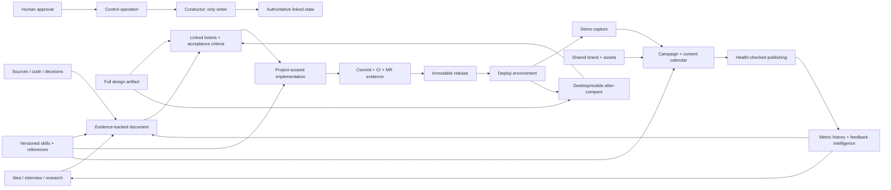

# Workspaces — zelfstandig product-gaprapport

**Peildatum:** 18 juli 2026  
**Quality gate:** **FAIL voor productie / self-hosted GA**  
**Uitvoering:** read-only; geen bestanden gewijzigd, tests gestart, containers geopend, providers aangeroepen of browsers gebruikt.

---

## 1. Metadata en methode

### Onderzoeksopzet

Dit rapport consolideert:

1. **1 Sol 5.6 product-map** — feitelijke productdefinitie en capabilitykaart;
2. **12 Terra 5.6-dimensiescans** — positionering, development, design, intelligence, documents, media, growth, koppelingen, mobile, extensibility, trust/ops en releasecoherentie;
3. **3 Sol 5.6 synthese-/verificatiestappen** — productsynthese, coupling-synthese en adversarial quality gate;
4. **1 Sol 5.6 eindredactie** — standalone rapportage en laatste deduplicatie;
5. actuele code als doorslaggevende bron bij conflicten.

Omdat het Design/Documents-programma tijdens de scan parallel doorbouwde, is de eindredactie opnieuw geverifieerd tegen commit `89c2f2b`: document-diff/history, exportfidelity én document-kind/user-authorable templates zijn daarom als gebouwd verwerkt.

### Bewijshiërarchie

1. Actuele bereikbare code en schema’s;
2. recente ADR’s;
3. actuele architectuurdocumentatie;
4. programma- en voortgangsdocumenten;
5. oude V1-documenten uitsluitend als historische context.

`src/workspaces/_docs/V1_SCOPE.md`, `src/workspaces/_docs/BUILD_HANDOFF.md` en `src/workspaces/_docs/BUILD_ORDER.md` beschrijven een vroegere single-provider/GitLab-only scope. Zij zijn **historische drift**, niet de actuele productgrens.

### Statuslabels

| Label | Betekenis |
|---|---|
| **CONFIRMED** | Het bestaan van de capability of gap is statisch bevestigd in actuele code. |
| **NEEDS-LIVE** | Docker, meerdere processen, een echt device, OAuth, DNS of een externe provider is nodig voor sluitend runtimebewijs. |
| **IDEA** | Roadmapkandidaat of nieuwe module; geen defect in de huidige implementatie. |
| **STALE-FIXED** | Oud gap dat aantoonbaar is opgelost en niet opnieuw als open werk mag terugkomen. |

**Nuance:** een codegap kan **CONFIRMED** zijn terwijl de precieze runtime-impact nog **NEEDS-LIVE** is.

---

## 2. Executive summary, productdefinitie en grenzen

### Definitieve productdefinitie

> **Workspaces is een modulair, self-hosted platform voor governed AI outcome delivery: mensen leveren een doel, brief, ticket, bron of document; AI voert gecontroleerde workflows uit of stelt acties voor; de mens keurt goed, stuurt bij en beantwoordt vragen; de Conductor blijft de enige gezaghebbende schrijver.**

De vier primaire outcome-modules zijn:

1. **Development** — software bouwen, testen, reviewen en uitrollen;
2. **Content** — media maken, bewerken, plannen en publiceren;
3. **Design** — visuele systemen en inspiratie ontwikkelen en aan software koppelen;
4. **Documents** — brongebaseerde documenten opstellen, reviewen en exporteren.

Studio/Marketing, Interviewer, Knowledge, Skills, Automations, Workspace-AI, Mobile en Usage zijn gedeelde werkvlakken boven dezelfde governance-, RAG-, provider-, asset-, realtime- en automationkern.

**Bewijs:** `src/workspaces/_data/modules.ts`, `src/workspaces/_shell/Shell.tsx`, `server/orchestrator/conductor.ts`, `server/ai/workspaceChat.ts`, `server/rag/`, `docs/decisions/0097-workspace-modules.md`, `docs/decisions/0049-content-platform-pivot.md`, `docs/decisions/0271-documents-module-markdown-bron-plus-render-targets.md`.

### Aanbevolen positionering

> **Van brief naar gecontroleerd resultaat — software, content, ontwerp of documenten — binnen één self-hosted workspace.**

De onderscheidende waarde is niet “veel AI-tools”, maar:

- één governance- en approvalmodel;
- één gedeelde workspacecontext;
- gecontroleerde pipelines;
- menselijke acceptatie vóór gezaghebbende writes;
- herbruikbare kennis, assets, skills en automations;
- phone-first supervisie;
- self-hosted controle over runtime en data.

### Hoofdconclusie

Workspaces bezit al uitzonderlijke breedte, vooral in Development en Content. De grootste gaten zijn niet nieuwe generatietools, maar:

1. **security en state integrity**;
2. **waarheidsgetrouwe CI/releaseprovenance**;
3. **duurzame jobs, retries en recovery**;
4. **betrouwbare phone approval**;
5. **lossless koppelingen tussen bestaande modules**;
6. **één artifact-, asset- en brandspine**;
7. **live bewijs voor self-hosting, providers en mobiele flows**.

### Productgrenzen

Workspaces is niet:

- een autonome writer buiten acceptatie → control-op → Conductor;
- een generieke Notion-, Word-, Canva-, Figma- of no-code-appbuilder;
- een volledige CRM, ERP, advertentie- of marketingdatawarehouse-suite;
- een offline-first mobiele writer;
- een keyless productiepad voor echte generatieve media;
- een hostile-public-SaaS zonder zwaardere host- en containerisolatie;
- een volledig ingebouwde forge/CI-cloud;
- een volwaardige Office round-trip-editor: Documents gebruikt Markdown als bron en PDF/DOCX/XLSX als renderdoelen.

### Canonieke producttruth ontbreekt

`docs/PRODUCT.md` is nog een scaffoldstub; `docs/AI_PRODUCT_OVERVIEW.md` mist intents voor meerdere kernpagina’s; `docs/product-knowledge/capabilities.md` dekt slechts een fractie van de actuele capabilities. Daardoor kunnen onboarding, Assistant en roadmap een onvolledig of verouderd productbeeld geven.

---

## 3. Capability-heatmap en kernjourneys

### 3.1 Capability-heatmap

Scores zijn statische volwassenheidsinschattingen, geen live SLA-meting.

| Module | Kernflow | Koppelingen | Phone-first | Productieproof | Dominant oordeel |
|---|---:|---:|---:|---:|---|
| Development | 4/5 | 2/5 | 1/5 | 1/5 | Sterke pipelinekern; projectscope, CI-SHA en releases zijn blockers. `server/orchestrator/stageRunner.ts`, `server/ci/`, `server/deploy/` |
| Designer | 3/5 | 2/5 | 1/5 | 2/5 | Library en compare bestaan; full-look, veilige capture en after-check ontbreken. `server/designer/`, `src/workspaces/designer/` |
| Interviewer | 3/5 | 2/5 | 2/5 | 2/5 | Repo-grounded findings werken; evidence, dedup en strategy-handoffs ontbreken. `server/interviewer/`, `src/workspaces/interviewer/page.tsx` |
| Documents/Knowledge | 3/5 | 1/5 | 2/5 | 1/5 | Ingest→template-guided draft→diff→export bestaat; provenance, privacy, diagrams en koppelingen blokkeren professioneel gebruik. `server/documents/`, `server/rag/graph.ts` |
| Studio/Media | 3/5 | 2/5 | 1/5 | 2/5 | Veel generators/editors; outputs eindigen vaak als preview of los asset. `server/studio/`, `server/media/`, `src/workspaces/studio/page.tsx` |
| Content/Publishing/Growth | 4/5 | 2/5 | 2/5 | 1/5 | Breed functioneel; publish reliability, accountcorrectheid en learn-loop ontbreken. `server/content/`, `src/workspaces/content/` |
| Skills/Automation/Extensibility | 3/5 | 2/5 | 2/5 | 1/5 | Goede interne basis; permissies, commands, runhistory en UI zijn onvoldoende betrouwbaar. `server/ai/skills.ts`, `server/automation/` |
| Workspace-AI/RAG/Search | 3/5 | 2/5 | 3/5 | 2/5 | Veel veilige proposals; niet modulebewust en geen volledige operationele catalogus. `server/ai/workspaceChat.ts`, `server/ai/opCatalog.ts` |
| Mobile/PWA/A11y | 2/5 | 2/5 | 2/5 | 1/5 | Mobile shell, voice en push bestaan; vraag→push→antwoord→ACK is onbetrouwbaar. `src/workspaces/_shell/`, `public/sw.js` |
| Platform/Ops | 3/5 | 2/5 | n.v.t. | 1/5 | Sterke governance-intentie; secrets, writers, proxy, deletion en DR blokkeren GA. `server/control/`, `server/tenant/`, `deploy/` |

### 3.2 Vijftien kernjourneys

| # | Journey | Huidige staat | Belangrijkste breekpunt |
|---:|---|---|---|
| J1 | Workspace maken → outcome kiezen → direct bruikbare setup | **CONFIRMED, zwak** | Modules zijn vooral navtoggles; non-dev workspaces krijgen alsnog project en dev-pipeline. `server/bootstrap/seedWorkspace.ts`, `src/workspaces/_data/modules.ts` |
| J2 | Idee/interview → requirementsdocument → tickets | **CONFIRMED, gebroken** | Finding kan alleen ticket/dismiss worden; Documents hebben geen ticketrelatie. `server/interviewer/findings.ts`, `server/documents/docs.ts` |
| J3 | Ticket → refine → plan → implement → test → review | **CONFIRMED, at risk** | Stage-identiteit verliest `projectId`. `server/orchestrator/stageRunner.ts`, `server/orchestrator/conductor.ts` |
| J4 | Agentcommit → CI → MR → promotie | **CONFIRMED, bewijs gebroken** | Vastgelegde SHA en feitelijk geteste bron kunnen verschillen. `server/ci/runner.ts`, `server/orchestrator/stageRunner.ts` |
| J5 | Deploy → releasehistorie → rollback | **CONFIRMED, gebroken** | Hergebruikte container kan oude code draaien; geen releasehistorie/rollback. `server/deploy/environment.ts`, `server/container/runtime.ts` |
| J6 | Deploy → demo → campagne → publish → feedback | **CONFIRMED, gesegmenteerd** | Geen deploy-event naar capture/campaign; feedback sluit de loop niet. `server/deploy/`, `server/content/capture.ts`, `server/content/commentInbox.ts` |
| J7 | Inspiratie → volledige look → code → after-compare | **CONFIRMED, partieel** | Alleen kleuren, lossy ticketcontext en geen deployed recapture. `server/designer/inspiration.ts`, `server/orchestrator/artifactContext.ts` |
| J8 | Studio landing/component → productroute → deploy | **CONFIRMED, dead end** | Output blijft iframe/copy/PNG. `src/workspaces/studio/page.tsx`, `server/deploy/environment.ts` |
| J9 | PDF/sources → tech design → implementatie → living docs | **CONFIRMED, partieel** | Parse, user-authorable templates, draftdiff en export werken; citations, diagrams en ticket/ADR-context ontbreken. `server/documents/parseUpload.ts`, `server/documents/templates.ts`, `server/documents/docs.ts` |
| J10 | Brief → script/storyboard → media → render | **CONFIRMED, partieel** | Script/beats zijn niet volledig reviewbaar vóór betaalde generatie. `server/content/script.ts`, `src/workspaces/content/[pieceId]/page.tsx` |
| J11 | Channel recipe → cron/autopilot → veel accounts | **CONFIRMED, UI-blocked** | Scheduled-form schrijft geen `channelId`; complete cloning ontbreekt. `src/workspaces/scheduled/page.tsx`, `server/content/ideatorRole.ts` |
| J12 | Schedule → publish → health/retry → analytics | **CONFIRMED, gebroken ops** | Geen retry/health/push; scheduled success mist `externalId`. `server/content/publish.ts` |
| J13 | Brand/assets/references/skills overal hergebruiken | **CONFIRMED, gefragmenteerd** | Meerdere brand- en assetmodellen met verschillende consumers. `prisma/schema.prisma`, `server/content/buildBrandContext.ts` |
| J14 | Phone push → vraag/approval → bevestigde hervatting | **CONFIRMED, onbetrouwbaar** | Geen directe vraagpush en geen write-ACK/retry. `server/orchestrator/stageRunner.ts`, `src/workspaces/_shell/WorkspacesProvider.tsx` |
| J15 | Self-host install → run → backup/delete/restore | **CONFIRMED, niet release-safe** | Delete en backup omvatten niet alle data/runtime; live recovery ontbreekt. `server/db/backup.ts`, `server/orchestrator/conductor.ts`, `deploy/` |

---

## 4. Top 25 op beslisvolgorde

Impact: **K**ritiek, **H**oog, **M**iddel. Effort: **S/M/L**.

| # | Gap | Impact / effort | Evidence | Confidence |
|---:|---|---:|---|---|
| 1 | Secrets en `webhookSecret` worden aan gewone workspaceleden geprojecteerd. | K/S | `server/read/workspaceSnapshot.ts`, `server/git/webhookRoute.ts` | Zeer hoog |
| 2 | Pipelinestages kunnen tussen projecten worden gelezen of gemuteerd doordat `projectId` wegvalt. | K/M | `prisma/schema.prisma`, `server/orchestrator/stageRunner.ts`, `server/orchestrator/conductor.ts` | Zeer hoog |
| 3 | Forge, Designer en background workers omzeilen delen van Conductor/single-writer/tenant-scope. | K/M | `server/git/webhookIngest.ts`, `server/git/gitlabSync.ts`, `src/workspaces/_api/designerInspiration_v1.ts`, `server/automation/cron.ts` | Hoog |
| 4 | Caddy Admin is bereikbaar op het gedeelde containernetwerk. | K/M | `deploy/Caddyfile`, `deploy/docker-compose.yml`, `server/container/editorSession.ts` | Zeer hoog |
| 5 | Designer-capture, scraper en deploy-hook missen één uniforme SSRF-/egressgrens. | K/M | `server/designer/inspiration.ts`, `server/scraper/role.ts`, `server/deploy/buildExport.ts` | Zeer hoog |
| 6 | `/media/*` is authloos; uploads/parsers missen MIME-, magic-, AV-, quota- en resourcechecks. | K/M | `server/media/download.ts`, `server/media/uploadRoute.ts`, `server/documents/parseUpload.ts`, `server/container/toolHarness.ts` | Zeer hoog |
| 7 | Workspace-delete ruimt niet alle modellen, blobs, repos, containers, routes en RAG op. | K/M–L | `server/orchestrator/conductor.ts`, `prisma/schema.prisma`, `server/media/store.ts` | Zeer hoog |
| 8 | Lease expiry en foutafhandeling kunnen overlappende writes of vals succesvolle ACKs geven. | H/M | `server/orchestrator/cluster.ts`, `server/orchestrator/conductor.ts`, `server/control/dispatchSync.ts` | Zeer hoog |
| 9 | CI kan een andere bron testen dan de vastgelegde commit; `needs` is geen echte DAG-scheduling. | K/M | `server/orchestrator/stageRunner.ts`, `server/ci/runner.ts`, `server/ci/parse.ts` | Zeer hoog |
| 10 | Redeploy/promotie kan oude of andere bron serveren terwijl een nieuwe SHA wordt gerapporteerd. | K/L | `server/container/runtime.ts`, `server/deploy/environment.ts`, `server/deploy/promote.ts`, `server/container/imageBuild.ts` | Zeer hoog |
| 11 | Stage-network, hooks, tools, processes en zichtbaarheid worden niet betrouwbaar uitgevoerd; vrije MCP-/shellcommands vergroten dit risico. | K/M | `server/orchestrator/renderStage.ts`, `server/orchestrator/stageRunner.ts`, `server/automation/executor.ts` | Zeer hoog |
| 12 | One-shot AI/media/jobs missen globale admission control; spend-cap is niet atomair. | H/M | `server/ai/registry.ts`, `server/orchestrator/capacity.ts`, `server/spend/record.ts`, `server/media/budget.ts` | Hoog |
| 13 | Backup, restore, upgrades en live multi-instancegedrag zijn niet GA-waardig bewezen. | H/L | `server/db/backup.ts`, `deploy/docker-compose.yml`, `docs/DR_RUNBOOK.md`, `prisma/schema.prisma` | Hoog |
| 14 | Nieuwe `needs-input`-vragen pushen niet direct; antwoorden/approvals missen ACK, pending en retry. | H/M | `server/orchestrator/stageRunner.ts`, `server/orchestrator/watchdog.ts`, `src/workspaces/_shell/WorkspacesProvider.tsx` | Zeer hoog |
| 15 | `Service.path` wordt niet consequent gebruikt door CI, preview, deploy en export. | H/M | `prisma/schema.prisma`, `server/ci/runner.ts`, `server/container/previewSession.ts`, `server/deploy/` | Zeer hoog |
| 16 | Scheduled publishing bevriest intent niet en mist correct accountgebruik, retries, health, `externalId` en TikTok-reachability. | H/M | `server/content/publish.ts`, `server/content/publishOAuth.ts`, `src/workspaces/content/[pieceId]/page.tsx` | Zeer hoog |
| 17 | Documentingest is niet duurzaam en mist OCR, provenance, citations en een sterke prompt-injectiongrens. | H/M–L | `server/documents/parseUpload.ts`, `server/documents/docs.ts`, `server/orchestrator/conductor.ts` | Zeer hoog |
| 18 | Geen duurzaam delivery-evidence- en releasehistoriepad. | H/M–L | `server/read/broadcast.ts`, `prisma/schema.prisma`, `server/deploy/` | Hoog |
| 19 | Producttruth en workspacepacks sturen onboarding en seed niet werkelijk. | H/M | `docs/PRODUCT.md`, `src/workspaces/_data/modules.ts`, `server/bootstrap/seedWorkspace.ts` | Zeer hoog |
| 20 | Studio/Designer-output bereikt repo, route, ticket en deploy niet lossless. | H/M–L | `server/orchestrator/artifactContext.ts`, `src/workspaces/studio/page.tsx`, `server/designer/` | Zeer hoog |
| 21 | Documents, tickets, decisions, findings, CI en deploy vormen geen verbonden artifactgraph. | H/L | `server/documents/docs.ts`, `server/rag/graph.ts`, `prisma/schema.prisma` | Zeer hoog |
| 22 | Geen universele asset-, brand-, rights- en provenancebron. | H/L | `prisma/schema.prisma`, `server/content/buildBrandContext.ts`, `server/studio/`, `server/designer/` | Hoog |
| 23 | Workspace-AI en automation-UI ontsluiten de bestaande control-plane niet volledig of modulebewust. | H/M | `server/ai/opCatalog.ts`, `server/ai/workspaceChat.ts`, `src/workspaces/scheduled/page.tsx` | Zeer hoog |
| 24 | Designer “Use this look” kan door stale React-state de vorige selectie toepassen. | H/S | `src/workspaces/designer/sections/Gallery.tsx`, `src/workspaces/designer/state.tsx` | Zeer hoog |
| 25 | Kernoppervlakken blijven desktop-dense en onvoldoende toegankelijk; Content mist bovendien pre-cost script/storyboardreview. | H/M | `src/workspaces/_components/primitives.tsx`, `src/workspaces/terminals/page.tsx`, `src/workspaces/content/[pieceId]/page.tsx`, `src/workspaces/designer/` | Hoog; UX-severity deels NEEDS-LIVE |

---

## 5. Stop-ship- en foundationgaps

### 5.1 Security en data-isolatie

| ID | Gate | Gap | Status | Bewijs |
|---|---|---|---|---|
| F01 | **STOP-SHIP** | Gewone EnvVar-secrets worden gedecrypt in membersnapshots. | CONFIRMED | `server/read/workspaceSnapshot.ts` |
| F02 | **STOP-SHIP** | `Workspace.webhookSecret` wordt plaintext aan leden geprojecteerd. | CONFIRMED | `server/read/workspaceSnapshot.ts`, `server/git/webhookRoute.ts` |
| F03 | **STOP-SHIP** | Caddy Admin luistert op het gedeelde containernetwerk. | CONFIRMED | `deploy/Caddyfile`, `deploy/docker-compose.yml` |
| F04 | **STOP-SHIP** | Designer-capture en scraper hebben geen private-IP/metadata-/redirectguard. | CONFIRMED | `server/designer/inspiration.ts`, `server/scraper/role.ts` |
| F05 | **STOP-SHIP** | `/media/<uuid>` heeft geen sessie-, tenant-, expiry- of revocationcontrole. | CONFIRMED | `server/media/download.ts`, `server/media/store.ts` |
| F06 | **STOP-SHIP** | Uploads vertrouwen extensies en missen MIME/magic/AV/quota; parsercontainers missen harde limieten. | CONFIRMED | `server/media/uploadRoute.ts`, `server/documents/parseUpload.ts`, `server/container/toolHarness.ts` |
| F07 | **FOUNDATION** | Stage-egressbeleid is cosmetisch; host-global egress staat standaard open. | CONFIRMED | `server/orchestrator/renderStage.ts`, `server/container/runtime.ts`, `server/container/egress.ts` |
| F08 | **STOP-SHIP** | Stage-MCP-selectie en `ro`/`rw`-tiers worden genegeerd; vrije commands krijgen secrets. | CONFIRMED | `server/orchestrator/stageRunner.ts`, `server/orchestrator/renderStage.ts` |
| F09 | **STOP-SHIP** | `run-command` gebruikt vrije `sh -lc` in plaats van de gedocumenteerde allowlistgrens. | CONFIRMED | `server/automation/executor.ts`, `src/workspaces/_docs/03_AUTOMATION_AND_PLUGINS.md` |
| F10 | **FOUNDATION** | Deploy-hooks missen de centrale webhook-SSRF-guard. | CONFIRMED | `server/deploy/buildExport.ts` |
| F11 | **FOUNDATION** | Preview- en environmentroutes missen aantoonbare membership-edge-auth. | CONFIRMED | `server/proxy/index.ts`, `server/container/previewSession.ts`, `server/deploy/environment.ts` |
| F12 | **FOUNDATION** | RAG kan code/documenttekst naar Gemini sturen zonder workspace-egressconsent of residencyweergave. | CONFIRMED | `server/rag/embed.ts`, `server/ai/registry.ts` |
| F13 | **FOUNDATION** | Onbetrouwbare documenten/RAG worden zonder sterke instruction-isolation in prompts geplaatst. | CONFIRMED | `server/documents/docs.ts`, `server/orchestrator/renderStage.ts`, `server/ai/workspaceChat.ts` |
| F14 | **FOUNDATION** | App-container heeft de volledige Docker socket; compromittering is hostkritiek. | CONFIRMED | `deploy/docker-compose.yml` |

### 5.2 Single-writer en tenantcontract

| ID | Gate | Gap | Status | Bewijs |
|---|---|---|---|---|
| F15 | **STOP-SHIP** | Forge-webhooks en polling schrijven tickets buiten Conductor/audit/lease. | CONFIRMED | `server/git/webhookIngest.ts`, `server/git/gitlabSync.ts` |
| F16 | **STOP-SHIP** | Designer compare schrijft `UiReviewRequest` rechtstreeks. | CONFIRMED | `src/workspaces/_api/designerInspiration_v1.ts`, `server/designer/inspiration.ts` |
| F17 | **STOP-SHIP** | StageRunner, watchdog, cron, comments en andere workers gebruiken raw Prisma buiten `runInTenant`. | CONFIRMED | `server/orchestrator/stageRunner.ts`, `server/orchestrator/watchdog.ts`, `server/automation/cron.ts`, `server/content/commentInbox.ts` |
| F18 | **STOP-SHIP** | Workspacelease verloopt na 15 seconden zonder renewal terwijl lange acties binnen de lease draaien. | CONFIRMED | `server/orchestrator/cluster.ts`, `server/orchestrator/conductor.ts` |
| F19 | **STOP-SHIP** | Execute-errors kunnen worden gelogd maar alsnog als succesvolle control-ACK terugkomen. | CONFIRMED | `server/orchestrator/conductor.ts`, `server/control/dispatchSync.ts` |
| F20 | **FOUNDATION** | Audit is best-effort, onvolledig en niet tamper-evident. | CONFIRMED | `server/control/audit.ts`, `server/orchestrator/conductor.ts` |

### 5.3 Project-, CI- en release-integriteit

| ID | Gate | Gap | Status | Bewijs |
|---|---|---|---|---|
| F21 | **STOP-SHIP** | Stage lookup, next-stage en mutations zijn niet overal projectscoped. | CONFIRMED | `prisma/schema.prisma`, `server/orchestrator/stageRunner.ts`, `server/orchestrator/conductor.ts` |
| F22 | **STOP-SHIP** | CI-metadata gebruikt een frozen SHA terwijl de job branch-tip kan clonen. | CONFIRMED | `server/orchestrator/stageRunner.ts`, `server/ci/runner.ts` |
| F23 | **FOUNDATION** | CI parseert `needs`, maar valideert/scheduleert geen echte DAG. | CONFIRMED | `server/ci/parse.ts`, `server/ci/runner.ts` |
| F24 | **OPEN BESLISSING** | Ontbrekende CI-config/Docker is nu niet-gating. Of CI verplicht moet zijn is productbeleid, geen bewezen defect. | CONFIRMED beleid | `server/ci/gate.ts`, `server/ci/runner.ts` |
| F25 | **STOP-SHIP** | Redeploy kan een bestaande container/volume hergebruiken maar een nieuwe SHA rapporteren. | CONFIRMED | `server/container/runtime.ts`, `server/deploy/environment.ts` |
| F26 | **STOP-SHIP** | Promotion pint niet aantoonbaar dezelfde geteste bronrevision. | CONFIRMED | `server/deploy/promote.ts`, `server/container/imageBuild.ts`, `server/deploy/environment.ts` |
| F27 | **FOUNDATION** | Geen deployment history, releasecompare of rollback. | CONFIRMED | `prisma/schema.prisma`, `server/deploy/` |
| F28 | **FOUNDATION** | `Service.path` wordt niet door CI/preview/deploy/export gerespecteerd. | CONFIRMED | `prisma/schema.prisma`, `server/ci/runner.ts`, `server/container/previewSession.ts`, `server/deploy/buildExport.ts` |
| F29 | **FOUNDATION** | Stage hooks, processes, visibility en toolconfiguratie zijn deels inert. | CONFIRMED | `server/orchestrator/renderStage.ts`, `server/orchestrator/stageRunner.ts` |
| F30 | **OPEN BESLISSING** | WIP is advisory, niet enforced. Dat vereist een expliciete productkeuze. | CONFIRMED beleid | `src/workspaces/board/[ticketId]/page.tsx`, `src/workspaces/pipeline/page.tsx` |
| F31 | **FOUNDATION** | PTY/tool/commandbewijs is vluchtig en niet duurzaam gekoppeld aan commit→CI→deploy. | CONFIRMED | `server/read/broadcast.ts`, `prisma/schema.prisma` |

### 5.4 Jobs, queues, publishing en capaciteit

| ID | Gate | Gap | Status | Bewijs |
|---|---|---|---|---|
| F32 | **FOUNDATION** | One-shot AI heeft geen globale concurrency/circuit-breaker vóór providerdispatch. | CONFIRMED | `server/ai/registry.ts`, `server/orchestrator/capacity.ts` |
| F33 | **FOUNDATION** | Media-generation mist appbrede fairness en per-workspacelimieten. | CONFIRMED | `server/media/`, `server/content/` |
| F34 | **FOUNDATION** | Host-spend-cap is read-then-write en gecachet; parallel werk kan overschrijden. | CONFIRMED | `server/spend/record.ts`, `server/media/budget.ts` |
| F35 | **FOUNDATION** | Documentextractie is fire-and-forget zonder durable job/retry/recovery. | CONFIRMED | `server/orchestrator/conductor.ts`, `server/documents/parseUpload.ts` |
| F36 | **FOUNDATION** | Designer capture is één lange request zonder job/progress/cancel/recovery. | CONFIRMED | `server/designer/inspiration.ts`, `src/workspaces/designer/page.tsx` |
| F37 | **FOUNDATION** | Interviewer-runs kunnen de serial Conductor-keten lang bezetten; runhistory is process-local. | CONFIRMED | `server/interviewer/role.ts`, `server/ai/activity.ts`, `server/orchestrator/conductor.ts` |
| F38 | **FOUNDATION** | Cron/trigger-runs missen durable attempts, retry, catch-up, dead letter en runhistory. | CONFIRMED | `server/automation/cron.ts`, `server/automation/executor.ts`, `prisma/schema.prisma` |
| F39 | **FOUNDATION** | Scheduled publish heeft geen attempts/backoff/retry/push/health. | CONFIRMED | `server/content/publish.ts`, `src/workspaces/scheduled-posts/page.tsx` |
| F40 | **FOUNDATION** | Scheduled payload wordt niet bevroren; actuele caption/privacy/disclosure wordt later herlezen. | CONFIRMED | `server/content/publish.ts`, `prisma/schema.prisma` |
| F41 | **FOUNDATION** | Composer kan `accounts[0]` boven de kanaaldefault kiezen. | CONFIRMED | `src/workspaces/content/[pieceId]/page.tsx`, `server/orchestrator/conductor.ts` |
| F42 | **FOUNDATION** | TikTok `PULL_FROM_URL` kan relatieve `/media/...`-assets niet extern ophalen. | CONFIRMED | `server/content/publishOAuth.ts`, `server/content/render.ts` |
| F43 | **FOUNDATION** | Scheduled success bewaart geen `externalId`; metrics/comments slaan het resultaat over. | CONFIRMED | `server/content/publish.ts`, `server/content/publishMetrics.ts`, `server/content/commentInbox.ts` |

### 5.5 Phone-ACK en herstel

| ID | Gate | Gap | Status | Bewijs |
|---|---|---|---|---|
| F44 | **FOUNDATION** | Nieuwe `needs-input`-vraag maakt geen directe push; reminder volgt pas veel later. | CONFIRMED | `server/orchestrator/stageRunner.ts`, `server/orchestrator/watchdog.ts` |
| F45 | **FOUNDATION** | Antwoorden, approvals en andere writes gebruiken vaak fire-and-forget `syncRequest`. | CONFIRMED | `src/workspaces/_shell/WorkspacesProvider.tsx`, `src/workspaces/board/[ticketId]/page.tsx` |
| F46 | **FOUNDATION** | Geen zichtbare offline/reconnectingstatus of herstelbare pending-actionstatus. | CONFIRMED | `src/workspaces/_shell/WorkspacesProvider.tsx`, `src/workspaces/_shell/WorkspacesContext.tsx` |

### 5.6 DR en self-hosting

| ID | Gate | Gap | Status | Bewijs |
|---|---|---|---|---|
| F47 | **STOP-SHIP** | Workspace-delete verwijdert niet alle data/runtime. | CONFIRMED | `server/orchestrator/conductor.ts`, `prisma/schema.prisma` |
| F48 | **FOUNDATION** | Geen blob-GC of aantoonbare revocation van verwijderde media. | CONFIRMED | `server/media/store.ts`, `server/media/download.ts` |
| F49 | **FOUNDATION** | Backup dekt vooral Mongo, niet volledig media, repos, app-data, secrets en off-host herstel. | CONFIRMED | `server/db/backup.ts`, `docs/DR_RUNBOOK.md` |
| F50 | **FOUNDATION** | Restore-test bewijst geen volledige installatie of corrupte backup. | CONFIRMED | `tests/integration/dbBackup.test.mts`, `docs/DR_RUNBOOK.md` |
| F51 | **FOUNDATION** | Geen versioned schema-upgrade/backfillmechanisme voor bestaande installs. | CONFIRMED | `prisma/schema.prisma`, afwezigheid van `prisma/migrations/` |
| F52 | **FOUNDATION** | Default compose wijst de app niet naar `caddy:2019`. | CONFIRMED | `server/proxy/caddyProvider.ts`, `deploy/docker-compose.yml` |
| F53 | **FOUNDATION** | Default compose draait één app-instance; echte N-instance-, lease- en Redis-failoverproof ontbreekt. | NEEDS-LIVE | `deploy/docker-compose.yml`, `tests/integration/multiInstance.test.mts` |
| F54 | **FOUNDATION** | Workspace-export/import is geen volledige portability- of restoreflow. | CONFIRMED | `server/export/workspaceExport.ts`, `server/export/workspaceImport.ts` |
| F55 | **FOUNDATION** | Retentiebeleid ontbreekt voor chat, comments, uploads en andere dataklassen. | CONFIRMED | `prisma/schema.prisma` |

---

## 6. Nieuwe tools en modules

Alle onderstaande items zijn **IDEA’s/roadmapkandidaten**, geen huidige defects. Exacte schema’s, API’s en events zijn niet besloten.

### 6.1 MUST — nodig om de bestaande productbelofte te sluiten

| IDEA | Waarom passend | Hergebruikte kern | Effort | Afhankelijkheden |
|---|---|---|---:|---|
| Product Truth & Readiness Catalog | Eén actuele bron voor capabilitystatus, setup en live bewijs. | Productknowledge, intents, health, tests | S–M | Factual statusmodel; onderhoudsproces |
| Workspace Recipe Packs | Maakt modules operationeel: pipeline, skills, templates, automations en seeds per outcome. | Modules, bootstrap, Skills, triggers | M | Producttruth; veilige import/export |
| Project Execution Capsules | Houdt project, stage, service, repo, CI en deploy consistent gescopeerd. | Project-, pipeline- en containerkern | M | F21–F29 |
| Delivery Evidence Ledger | Verbindt agentturns, commands, diffs, SHA, CI, MR, approvals en deploy. | TicketEvent, audit, CI, MR | M–L | Betrouwbare provenance en retentie |
| Immutable Release Manager | Exacte bronidentiteit, releasehistorie, compare en rollback. | Environment, CI gates, deploy | L | CI-SHA en servicepath eerst |
| Policy CI Profiles | Expliciete required checks per omgeving en echte DAG-semantiek. | Built-in CI, security findings | M | OPEN BESLISSING over verplichte CI |
| Durable Run & Job Controller | Parse, research, AI, export, capture en publish krijgen status/retry/history. | Conductor resultwrites, notifications, leader loops | L | Lease, tenant-scope, capacity |
| Universal Work Artifact Graph | Typed links tussen docs, tickets, findings, decisions, design, media, MR, CI en deploy. | RAG, graph, artifactlinks | L | OPEN BESLISSING over relationeel model |
| Source Intelligence | OCR, source manifests, citations, trustlabels en veilige extractie. | Tool harness, RAG, Documents | M–L | Media-ACL en uploadhardening |
| Universal Asset & Brand Spine | Eén versioned bron voor assets, variants, rights, provenance en merkcontext. | Media store, styles, brand-RAG | L | OPEN BESLISSING over migratie/canonical bron |
| Channel Autopilot Control Tower | Kanaal/accounthealth, consent, budget, retries, dead letter en push. | Channel, PublishJob, OAuth, automations | M–L | F39–F43 |
| Self-host Trust Center | Setup-, backup-, upgrade-, security-, provider- en capacityhealth. | Health, observability, DR, usage | M–L | Eerst betrouwbare probes en restoreproof |

### 6.2 SHOULD — verdieping van bestaande modules

| IDEA | Waarom passend | Hergebruikte kern | Effort | Afhankelijkheden |
|---|---|---|---:|---|
| Document Blueprint Ecosystem | Breidt de al gebouwde technical-design + user-authorable templates uit met variabelen, validatieregels, exportthema’s en extra packs (PRD, SOP, voorstel, release notes). | Markdown, Skills, `DocumentTemplate` | M | Bronprovenance; versie-/portabilitycontract |
| Rich Document Renderer | Eén consistente AST voor preview/PDF/DOCX/HTML/XLSX, diagrams en images. | Export/tool harness, Design-assets | L | Rendererkeuze; sandboxing |
| Review & Living Docs | Diff, comments, restore, freshness en voorgestelde updates uit deliveryevents. | Revisions, notifications, automations | M–L | Artifactlinks en eventcatalogus |
| Evidence-backed Research Runs | Bewaart scope, bronnen, excerpts, confidence, kosten en resultaat. | Interviewer, RAG, AiRun | M | Veilige durable jobs en egress |
| Interview Playbooks | Discovery, PRD, architectuur, risk, incident en retro. | Question cards, findings, Documents | M | Output- en approvalcontract |
| Design Lifecycle & Visual Validation | Full-look import, structured handoff en desktop/mobile after-compare. | Designer, screenshot harness, deploy | M–L | Veilige capture; deployevents |
| Creative Review Pack | Script/beat/storyboardreview vóór betaalde generatie. | Script, Beat, VideoScene, lineage | M | Snapshot/UI-projectie |
| Caption & Localization Pack | Styling, vertaling, dubbing en localevarianten. | SRT/VTT, voice, ffmpeg | L | Assetlineage, language/voicepolicy |
| Campaign Variant Engine | Thumbnail-, titel-, CTA- en metadata-experimenten. | Shortlinks, publish variants, metrics | M–L | Metricstijdreeks |
| Growth Intelligence | SEO, trends, experimenten, attribution en learnings. | Insights, comments, Interviewer | M–L | Betrouwbare data-ingest |
| Studio → Distribution Bridge | Calendar→posts, thumbnail→platform, landing→project/deploy. | Studio, Content, deploy, channels | M–L | Artifactgraph; releaseintegriteit |
| Agent-role Library | Declaratieve rollen met input/output, allowed tools en cost class. | AgentRole, Skills, control-ops | M | Capability- en sandboxcontract |
| Automation Action Library | Typed acties boven bestaande control-ops met approvalclassificatie. | Triggers, Conductor, RBAC | M | Durable runs; idempotency |
| Connector SDK | OAuth, secretrefs, sync cursors, records, webhookverify en tests. | Integrations, secrets, triggers | L | Egress- en capabilitygrens |
| Public Integration Gateway | Scoped API, webhooks, async opstatus en eventueel Workspaces-MCP. | PAT, RBAC, operationlogs | L | Rate limits, audit, connectorcontract |
| Organization Playbook Registry | Reviewed/versioned recipes voor teams en bureaus. | Recipe packs, workspace import/export | M–L | Packs en ownershipmodel |

### 6.3 LATER — aangrenzende expansie

| IDEA | Waarom passend | Hergebruikte kern | Effort | Afhankelijkheden |
|---|---|---|---:|---|
| Owned Audience / nieuwsbrief | Studio maakt al e-mailcopy; voegt consented delivery en metrics toe. | Studio, Content, metrics | M–L | Lists/consent; publish reliability |
| Blog/RSS publishing | Logische owned-channeluitbreiding. | Documents/Content, publish adapters | M | Canonical URLs en outputtemplates |
| Instagram/LinkedIn en extra channels | Vergroot bereik zonder nieuwe productkern. | Publishadapter, OAuth, Control Tower | L | Stabiel adapter-/healthcontract |
| Podcast/audio distribution | Voice/music bestaan; voegt audio-export en RSS toe. | Voice, assets, outputtemplates | M | Long-form uploads, rights |
| Localization/dubbing suite | Meertalige varianten van bestaande content. | Voice, captions, media lineage | L | Caption/localization pack |
| Competitor research/watchlists | Periodieke snapshots/diffs naar Interviewer. | Scraper, RAG, automations | M | SSRF-veilige research jobs |
| Community Intelligence | Commentsentiment en thema’s naar Ideator/Interviewer. | Comment inbox, RAG | M | Privacy/retentie; replies apart |
| Agency/client pack | Gescheiden klantcontext, approvals, packs en rapportage. | Workspace, RBAC, multi-project | L | Cloning, brand/assets, recipes |
| Signed declarative marketplace | Distributie van gecontroleerde packs/connectors/roles. | Registry, signatures, SDK | L | Eerst stabiele contracts |
| Research/source watch center | Nieuwe of gewijzigde bronnen signaleren en koppelen aan docs/tickets. | Source Intelligence, automation | M | Durable runs, typed links |

### 6.4 Out of scope

- Volwaardige CRM/ERP of leadpipeline;
- advertentie-inkoop en algemeen ad-accountbeheer;
- affiliate- of commissionadministratie;
- generieke Word/Notion/Canva/Figma-vervanging;
- marketplace voor arbitraire Node-code, shell- of MCP-commands;
- autonome AI-writes buiten Conductor;
- offline authoritative writes;
- automatisch beantwoorden van social comments zonder nieuw consentbeleid;
- hostile-public multitenant SaaS zonder fundamenteel zwaardere isolation.

---

## 7. Per-module polish en gaps

Cross-moduleovergangen verwijzen naar de edge-ID’s in §8 om duplicatie te beperken.

### 7.1 Development

| Gap/polish | Status | Bewijs | Coupling |
|---|---|---|---|
| Projectscope valt weg in stage runtime en mutations. | CONFIRMED | `server/orchestrator/stageRunner.ts`, `server/orchestrator/conductor.ts` | E15 |
| Network, hooks, tools, processes en visibility worden niet volledig uitgevoerd. | CONFIRMED | `server/orchestrator/renderStage.ts`, `server/container/runtime.ts` | E16 |
| CI-SHA, DAG en releasebron zijn niet eenduidig. | CONFIRMED | `server/ci/`, `server/deploy/` | E17–E21 |
| `Service.path` is operationeel grotendeels dood. | CONFIRMED | `server/ci/runner.ts`, `server/container/previewSession.ts`, `server/deploy/` | E19 |
| WIP is alleen advisory. | CONFIRMED; OPEN BESLISSING | `src/workspaces/pipeline/page.tsx`, `src/workspaces/board/[ticketId]/page.tsx` | — |
| Geen duurzaam commando-/tool-/releasebewijs. | CONFIRMED | `server/read/broadcast.ts`, `prisma/schema.prisma` | E23 |
| MR/diff en terminal zijn niet phone-first. | CONFIRMED; UX-severity NEEDS-LIVE | `src/workspaces/terminals/page.tsx`, `src/workspaces/board/[ticketId]/DiffView.tsx` | — |

### 7.2 Designer

| Gap/polish | Status | Bewijs | Coupling |
|---|---|---|---|
| “Use this look” kan de vorige selectie toepassen. | CONFIRMED | `src/workspaces/designer/sections/Gallery.tsx`, `src/workspaces/designer/state.tsx` | E28 |
| Inspiratie extraheert alleen kleuren. | CONFIRMED | `server/designer/inspiration.ts` | E26 |
| Capture is desktop-only, blocking en SSRF-gevoelig. | CONFIRMED | `server/designer/inspiration.ts`, `src/workspaces/designer/page.tsx` | E27 |
| Bron-URL, screenshot en extractmetadata gaan verloren. | CONFIRMED | `server/designer/inspiration.ts` | E26–E27 |
| Compare→ticket mist gekozen project en artifactlink. | CONFIRMED | `server/orchestrator/conductor.ts` | E29 |
| Studio-HTML, animation en enkele stylevelden gaan verloren bij agenthandoff. | CONFIRMED | `server/orchestrator/artifactContext.ts`, `server/designer/designSystemDoc.ts` | E25, E29–E30 |
| Edit/delete/versioning is onvolledig; delete kan na refresh terugkomen. | CONFIRMED | `src/workspaces/designer/state.tsx`, `server/designer/library.ts` | E32 |
| Components-tab is geen runtime componentinventory; contrastcontrole is beperkt. | CONFIRMED | `src/workspaces/designer/sections/Components.tsx`, `Themes.tsx` | — |
| Vaste rails en klikbare `
`s zijn zwak voor mobiel/keyboard. | CONFIRMED; severity NEEDS-LIVE | `src/workspaces/designer/sections/` | — |

### 7.3 Interviewer

| Gap/polish | Status | Bewijs | Coupling |
|---|---|---|---|
| Geen dedup; detail/evidence/confidence/effort ontbreken. | CONFIRMED | `server/interviewer/findings.ts`, `prisma/schema.prisma` | E03 |
| Severity volgt categorie in plaats van onderbouwde impact/kans. | CONFIRMED | `server/interviewer/findings.ts` | E03 |
| Finding→ticket verliest actieve projectcontext. | CONFIRMED | `src/workspaces/_shell/WorkspacesProvider.tsx`, `src/workspaces/_sync/findingAction_server_v1.ts` | E02 |
| Gesprek wordt lokaal gerenderd en is niet resumable in de pagina. | CONFIRMED | `src/workspaces/interviewer/page.tsx`, `prisma/schema.prisma` | E07 |
| Proposal/plan/copilot-output van Workspace-AI wordt weggegooid. | CONFIRMED | `src/workspaces/interviewer/page.tsx`, `server/ai/workspaceChat.ts` | E07 |
| Geen memory, CI/MR/deploy/spend/audit/comments in de analyse. | CONFIRMED | `server/interviewer/role.ts` | E04–E05 |
| Runs kunnen de serial writeketen lang bezetten en missen duurzame runhistory. | CONFIRMED | `server/interviewer/role.ts`, `server/ai/activity.ts` | E53 |
| Handoff beperkt tot ticket of dismiss. | CONFIRMED | `src/workspaces/_sync/findingAction_server_v1.ts`, `server/orchestrator/conductor.ts` | E01 |
| Scheduled findings missen relevante deep-link. | CONFIRMED | `server/automation/executor.ts` | E06 |

### 7.4 Documents/Knowledge

| Gap/polish | Status | Bewijs | Coupling |
|---|---|---|---|
| Geen OCR en geen durable ingest/retry/push. | CONFIRMED | `server/documents/parseUpload.ts`, `server/orchestrator/conductor.ts` | E11–E12 |
| Geen source manifest, citations, pagina/offset/hash of parserprovenance. | CONFIRMED | `server/documents/docs.ts`, `prisma/schema.prisma` | E12 |
| Bronmateriaal wordt stil afgekapt en als promptcontext gebruikt. | CONFIRMED | `server/documents/docs.ts` | E10, E12 |
| Extractie is niet inspecteerbaar of als editable Markdown importeertbaar. | CONFIRMED | `server/read/workspaceSnapshot.ts`, `src/workspaces/documents/[docId]/page.tsx` | E11 |
| Document-kind, technical-design en user-authorable templates bestaan; generation blijft één completion met verplichte section-structuur, niet een afzonderlijk gegenereerde/gevalideerde pass per sectie. | CONFIRMED, partieel gebouwd | `prisma/schema.prisma`, `server/documents/templates.ts`, `server/documents/docs.ts` | — |
| HTML/PDF ondersteunen nu inline images, links, fenced code en TOC; Mermaid, footnotes, paginanummers en consistente docx-branding blijven open. | CONFIRMED, partieel gebouwd | `src/workspaces/_components/MarkdownView.tsx`, `server/documents/export.ts` | — |
| Tickets, projects, ADR’s, CI en MR zijn niet linked/grounded. | CONFIRMED | `server/documents/docs.ts`, `prisma/schema.prisma` | E08–E09 |
| Asset-corpus wordt geïndexeerd maar niet breed opgehaald. | CONFIRMED | `server/documents/docs.ts`, `server/rag/` | E10 |
| Knowledge graph en Cmd-K missen Documents en andere artifacts. | CONFIRMED | `server/rag/graph.ts`, `src/workspaces/_shell/SearchPalette.tsx` | E13, E51 |
| Publieke media-URLs blokkeren gevoelige documentuse-cases. | CONFIRMED | `server/media/download.ts` | E56 |
| Diff/history/restore bestaan; collaboration/comments/auteurschap ontbreken. | CONFIRMED | `src/workspaces/documents/[docId]/page.tsx`, `prisma/schema.prisma` | — |

### 7.5 Studio/Media

| Gap/polish | Status | Bewijs | Coupling |
|---|---|---|---|
| Landing/component blijft iframe/copy/PNG, niet route/deploy. | CONFIRMED | `src/workspaces/studio/page.tsx`, `server/studio/generate.ts` | E24 |
| Social calendar maakt geen pieces of PublishJobs. | CONFIRMED | `server/studio/generate.ts`, `server/orchestrator/conductor.ts` | E33 |
| Thumbnail-PNG wordt geen ContentAsset of platformthumbnail. | CONFIRMED | `src/workspaces/studio/page.tsx`, `server/content/publishOAuth.ts` | E34 |
| VideoScript wordt een JSON-blob in plaats van editbare beats/scenes. | CONFIRMED | `server/orchestrator/conductor.ts` | E35 |
| Providerassets worden niet altijd lokaal genormaliseerd. | CONFIRMED | `server/media/`, `src/workspaces/content/page.tsx` | E47 |
| Upload buffert tot 64 MB in RAM; geen resumable long-form upload. | CONFIRMED | `server/media/uploadRoute.ts` | — |
| Geen zichtbare lineageboom/compare/restore of rightsmodel. | CONFIRMED | `prisma/schema.prisma`, `server/media/store.ts` | E56 |
| Kosten zijn deels schattingen, niet billing-grade reconciliatie. | CONFIRMED | `server/media/registry.ts`, `server/spend/record.ts` | E60 |
| Studio heeft een vaste desktoprail. | CONFIRMED; severity NEEDS-LIVE | `src/workspaces/studio/page.tsx` | — |

### 7.6 Content/Publishing/Growth

| Gap/polish | Status | Bewijs | Coupling |
|---|---|---|---|
| Script/beats/storyboard zijn niet volledig reviewbaar vóór kosten. | CONFIRMED | `server/content/script.ts`, `src/workspaces/content/[pieceId]/page.tsx` | — |
| SRT/VTT is backend-output maar niet goed ontsloten; captionstyling is minimaal. | CONFIRMED | `server/content/assembly.ts`, `server/read/mappers.ts`, `server/content/render.ts` | — |
| `endTrimMs` wordt opgeslagen maar niet correct in rendering gebruikt. | CONFIRMED | `prisma/schema.prisma`, `server/content/render.ts` | — |
| Crossfades kunnen clipaudio laten verdwijnen; audiotijdlijn/SFX is dun. | CONFIRMED | `server/content/render.ts`, `src/workspaces/content/VideoTimelineEditor.tsx` | — |
| Channelpicker ontbreekt in Scheduled. | CONFIRMED | `src/workspaces/scheduled/page.tsx`, `server/content/ideatorRole.ts` | E36 |
| Publish intent, account, TikTok-URL, retries en `externalId` zijn onbetrouwbaar. | CONFIRMED | `server/content/publish.ts`, `server/content/publishOAuth.ts` | E38–E42 |
| Metrics zijn geen tijdreeks; views domineren learnings. | CONFIRMED | `server/content/publishMetrics.ts`, `server/content/contentAnalytics.ts` | E43 |
| Comments voeden Ideator/Interviewer niet. | CONFIRMED | `server/content/commentInbox.ts`, `server/content/ideatorRole.ts` | E05 |
| Channel style/brandcontext wordt niet consequent toegepast. | CONFIRMED | `server/content/buildBrandContext.ts`, `server/content/brandMemory.ts` | E48–E49 |
| Contentboard en timeline zijn desktop-/input-dense. | CONFIRMED; severity NEEDS-LIVE | `src/workspaces/content/page.tsx`, `VideoTimelineEditor.tsx` | — |

### 7.7 Skills/Automation/Extensibility

| Gap/polish | Status | Bewijs | Coupling |
|---|---|---|---|
| Twee skillsystemen concurreren; `ws-skill`-runtime is niet aangetoond. | CONFIRMED | `server/ai/skills.ts`, `server/orchestrator/renderStage.ts` | E50 |
| Stage-integraties negeren tools/tier en accepteren vrije commands. | CONFIRMED | `server/orchestrator/stageRunner.ts`, `renderStage.ts` | E16, E50 |
| Pipeline `roleKey` wordt niet als echte rolruntime gebruikt. | CONFIRMED | `prisma/schema.prisma`, `server/orchestrator/stageRunner.ts` | — |
| Custom AI tasks missen typed input/output, versioning en schedule-binding. | CONFIRMED | `prisma/schema.prisma`, `server/automation/` | E52 |
| Scheduler-UI ontsluit slechts cron + role/notify. | CONFIRMED | `src/workspaces/scheduled/page.tsx`, `server/automation/executor.ts` | E52 |
| Geen durable TriggerRun/retry/dead letter/timezone/catch-up. | CONFIRMED | `server/automation/cron.ts`, `prisma/schema.prisma` | E53 |
| Outbound webhooks missen signing, idempotency en deliverylog. | CONFIRMED | `server/automation/executor.ts` | — |
| Public API is smal; geen operationstatus of eventsubscriptions. | CONFIRMED | `server/auth/publicApiRoute.ts` | — |
| Geen connector SDK of complete forgecapability-interface. | CONFIRMED | `server/integrations/`, `server/git/forgeProvider.ts` | — |
| Workspace export/import en `copy-workspace-assets` zijn geen volledige clone. | CONFIRMED | `server/export/`, `server/orchestrator/conductor.ts` | E37 |

### 7.8 Workspace-AI/RAG/Search

| Gap/polish | Status | Bewijs | Coupling |
|---|---|---|---|
| Documents-, skill-, trigger-save- en publish-ops staan op `later`. | CONFIRMED | `server/ai/opCatalog.ts` | E45 |
| Assistant leest `enabledSections` niet en kan irrelevante dev-ops aanbieden. | CONFIRMED | `server/ai/workspaceChat.ts`, `src/workspaces/_data/modules.ts` | E46 |
| Knowledge graph bevat alleen source/ticket/piece en vooral similarity. | CONFIRMED | `server/rag/graph.ts` | E51 |
| Corpora hebben verschillende consumers; document-assets/design/memory worden niet uniform opgehaald. | CONFIRMED | `server/rag/`, `server/documents/docs.ts`, `server/interviewer/role.ts` | E04, E10, E49 |
| Cmd-K zoekt slechts een beperkt deel van de workspace. | CONFIRMED | `src/workspaces/_shell/SearchPalette.tsx` | E13 |
| Usage/flowmetrics worden getoond maar nauwelijks door Assistant/Interviewer gebruikt. | CONFIRMED | `server/read/workspaceSnapshot.ts`, `server/obs/insights.ts`, `server/ai/workspaceChat.ts` | E04 |
| Productknowledge en page intents lopen achter op de code. | CONFIRMED | `docs/product-knowledge/`, `docs/AI_PRODUCT_OVERVIEW.md` | — |

### 7.9 Mobile/PWA/A11y

| Gap/polish | Status | Bewijs |
|---|---|---|
| Geen directe vraagpush en betrouwbare action-ACK. | CONFIRMED | `server/orchestrator/stageRunner.ts`, `src/workspaces/_shell/WorkspacesProvider.tsx` |
| Geen zichtbare offline/reconnectingstatus. | CONFIRMED | `WorkspacesProvider.tsx`, `WorkspacesContext.tsx` |
| iOS-installinstructie en heldere pushfoutstatus ontbreken. | CONFIRMED | `src/workspaces/_functions/installPrompt.ts`, `src/workspaces/settings/page.tsx` |
| Nieuwe workspace maken/beheren ontbreekt mobiel; headerknop is inert. | CONFIRMED | `src/workspaces/_shell/MobileChrome.tsx` |
| FAB is index-/moduleafhankelijk en kan verkeerd of onzichtbaar zijn. | CONFIRMED | `src/workspaces/_shell/Shell.tsx`, `MobileChrome.tsx` |
| Safe areas/dynamic viewport zijn onvolledig. | CONFIRMED | `src/index.css`, `MobileChrome.tsx` |
| Veel controls zijn 28–36px en inputs kleiner dan 16px. | CONFIRMED | `src/workspaces/_components/primitives.tsx`, diverse pages |
| Terminal mist mobiele modifier-/pijlentoetsen en toegankelijk transcript. | CONFIRMED | `src/workspaces/terminals/page.tsx`, `XtermTerminal.tsx` |
| Designer/Studio/Content houden desktoprails of brede kanban. | CONFIRMED; bruikbaarheid NEEDS-LIVE | `src/workspaces/designer/`, `studio/page.tsx`, `content/page.tsx` |
| Modals missen dialogsemantiek/focustrap; toggles missen switchsemantiek. | CONFIRMED | `src/workspaces/_components/MenuHandler.tsx`, `primitives.tsx` |
| Geen voldoende `aria-live`; runtime documenttaal blijft Engels. | CONFIRMED | `src/index.html`, `src/workspaces/_shell/Shell.tsx` |
| Mobile UX, iOS-PWA en screenreaderkwaliteit moeten live worden bewezen. | NEEDS-LIVE | `public/sw.js`, mobiele pages |

### 7.10 Platform/Ops

De primaire platformgaps staan in F01–F55. Aanvullend:

- PATs missen expiry/rotatie en expliciete abuse-telemetry: `prisma/schema.prisma`, `server/auth/publicApiRoute.ts`.
- Encryptie mist keyrotation; legacy `plain:` blijft leesbaar: `server/crypto/secretBox.ts`.
- `/metrics` is via de hoofdproxy bereikbaar: `server/obs/endpoints.ts`, `deploy/Caddyfile`.
- Budget `pauseAll` gedraagt zich feitelijk als `pauseNew`: `server/orchestrator/conductor.ts`, `server/spend/record.ts`.
- AI/media-kosten zijn niet billing-grade: `server/media/registry.ts`, `server/spend/record.ts`.
- Route-local business-logictests en browser-E2E dekken weinig kernjourneys: `docs/AI_PROJECT_INDEX.md`, `tests/e2e/example.spec.ts`.

---

## 8. Module-coupling gaps

### 8.1 Gapregister — 60 unieke edges

#### A. Intake, intelligence en Documents

| ID | From → To | Missing/weak edge | User consequence | Evidence | I/E | Status |
|---|---|---|---|---|---:|---|
| E01 | Interviewer → Documents/decision | Geen PRD/tech-design/ADR-handoff | Idee wordt direct een dun ticket | `src/workspaces/_sync/findingAction_server_v1.ts`, `server/orchestrator/conductor.ts` | H/M | CONFIRMED |
| E02 | InterviewFinding → actief project | `projectId` verdwijnt client/sync | Ticket kan in verkeerd project landen | `WorkspacesProvider.tsx`, `findingAction_server_v1.ts` | H/S | CONFIRMED |
| E03 | Interviewer-run → finding | Geen citations, dedup, confidence, effort, detail | Duplicaten en slecht toetsbare findings | `server/interviewer/findings.ts`, `prisma/schema.prisma` | H/M | CONFIRMED |
| E04 | Memory/CI/MR/deploy/spend/audit → Interviewer | Signalen bereiken prompt niet | Analyse mist echte regressies en besluiten | `server/interviewer/role.ts`, `server/rag/memory.ts`, `server/obs/insights.ts` | H/M | CONFIRMED |
| E05 | Social comments → Ideator/Interviewer | Geen sentiment-/themaroute | Feedback beïnvloedt volgende content niet | `server/content/commentInbox.ts`, `server/content/ideatorRole.ts` | H/M | CONFIRMED |
| E06 | Scheduled Interviewer → Notifications | Geen finding-deep-link | Push opent root | `server/automation/executor.ts` | H/S | CONFIRMED |
| E07 | Workspace-AI-resultaat → Interviewer-UI | Proposal/plan/copilot wordt genegeerd | Rijke output wordt platte tekst | `src/workspaces/interviewer/page.tsx`, `server/ai/workspaceChat.ts` | H/S | CONFIRMED |
| E08 | Documents ↔ Tickets/Projects | Geen relationele link/panel | Specs en implementatie drijven uiteen | `prisma/schema.prisma`, `TicketArtifactLink` | H/M | CONFIRMED |
| E09 | Tickets/ADRs/CI/MR → Document AI | Geen delivery-grounding | Tech designs/release docs verouderen | `server/documents/docs.ts` | H/M | CONFIRMED |
| E10 | Doc-assets-RAG → Document AI/chat | Corpus geïndexeerd maar niet breed opgehaald | Bronnen blijven onvindbaar | `server/documents/docs.ts`, `server/rag/` | H/M | CONFIRMED |
| E11 | Upload → durable ingest job | Fire-and-forget | Asset kan permanent `pending` blijven | `server/orchestrator/conductor.ts`, `server/documents/parseUpload.ts` | H/M | CONFIRMED |
| E12 | Bron → trusted citation/OCR | Geen OCR/manifest/offset/hash/trust | Scans falen; claims niet herleidbaar | `parseUpload.ts`, `Document.assets` | H/M | CONFIRMED |
| E13 | Documents → Knowledge/Search | Geen documentnodes; Cmd-K zoekt beperkt | Documenten zijn slecht vindbaar | `server/rag/graph.ts`, `SearchPalette.tsx` | M/M | CONFIRMED |
| E14 | Shared assets → Documents | Alleen nieuwe imagegeneratie | Goedgekeurde assets worden opnieuw gemaakt | `server/documents/docs.ts`, `server/media/` | M/S | CONFIRMED |

#### B. Development, CI en release

| ID | From → To | Missing/weak edge | User consequence | Evidence | I/E | Status |
|---|---|---|---|---|---:|---|
| E15 | Project → pipeline runtime/config | Projectscope valt weg | Project A/B kunnen elkaar beïnvloeden | `stageRunner.ts`, `conductor.ts`, `schema.prisma` | K/M | CONFIRMED |
| E16 | Pipeline editor → agent runtime | Network/hooks/tools/processes/visibility niet faithful | UI belooft beleid dat niet geldt | `renderStage.ts`, `stageRunner.ts`, `runtime.ts` | K/M | CONFIRMED |
| E17 | Agentcommit → CI | Vastgelegde SHA ≠ mogelijk geteste branch-tip | Groen bewijs kan verkeerde commit gelden | `stageRunner.ts`, `server/ci/runner.ts` | K/M | CONFIRMED |
| E18 | CI needs/policy → scheduler/gates | Geen echte DAG; no-CI niet gating | Releasebeleid geeft schijnzekerheid | `server/ci/parse.ts`, `server/ci/gate.ts` | H/M | CONFIRMED; policy OPEN BESLISSING |
| E19 | Service.path → CI/deploy/preview/export | Alles werkt vanuit root `/work` | Monoreposervices zijn geen echte units | `schema.prisma`, `server/ci/runner.ts`, `server/deploy/` | H/M | CONFIRMED |
| E20 | Deploy/promotion → immutable tested source | Container/source kan verschillen | Release draait ander werk dan bewezen | `container/runtime.ts`, `deploy/environment.ts`, `deploy/promote.ts` | K/L | CONFIRMED; runtime NEEDS-LIVE |
| E21 | Deploy → releasehistory/rollback | Alleen huidige Environment-state | Geen veilige compare/rollback | `schema.prisma`, `server/deploy/` | H/M | CONFIRMED |
| E22 | Background worker → runInTenant | Raw Prisma op meerdere paden | Tenantinvariant niet afgedwongen | `stageRunner.ts`, `watchdog.ts`, `automation/cron.ts` | K/M | CONFIRMED |
| E23 | Agent execution → delivery evidence | PTY/tooloutput niet duurzaam gekoppeld | Approval is niet auditbaar | `server/read/broadcast.ts`, `TicketEvent` schema | H/M | CONFIRMED |

#### C. Designer en Studio

| ID | From → To | Missing/weak edge | User consequence | Evidence | I/E | Status |
|---|---|---|---|---|---:|---|
| E24 | Studio landing/component → repo/route/deploy | Geen deployable handoff | Output blijft preview | `studio/page.tsx`, `deploy/environment.ts` | H/L | CONFIRMED |
| E25 | Studio HTML → coding agent | HTML wordt expliciet weggelaten | Agent mist concrete layoutreferentie | `server/orchestrator/artifactContext.ts` | H/S | CONFIRMED |
| E26 | Inspiration → full look | Alleen kleurentokens | Type, spacing, radius, shadows, motion verdwijnen | `server/designer/inspiration.ts` | H/M | CONFIRMED |
| E27 | URL → veilige async mobile capture | Blocking desktopcontainer zonder guard/job | Phoneflow breekt; SSRF-risico | `server/designer/inspiration.ts`, `designer/page.tsx` | K/M | CONFIRMED |
| E28 | Gallery selection → applied look | Stale React-closure | Vorige look kan worden geactiveerd | `Gallery.tsx`, `designer/state.tsx` | H/S | CONFIRMED |
| E29 | Compare → project + artifactlink | Eerste project; alleen prose/screenshots | Agent moet look opnieuw interpreteren | `server/orchestrator/conductor.ts` | H/M | CONFIRMED |
| E30 | Active look → code | Alleen context voor volgende run | “Use in project” wijzigt UI niet | `designSystemDoc.ts`, `stageRunner.ts` | H/M | CONFIRMED |
| E31 | Deployed redesign → after-compare | Geen recapture-event | Geen bewijs van verbetering | `server/deploy/`, `server/designer/inspiration.ts` | H/M | CONFIRMED |
| E32 | Designer library → RAG/history/portability | Geen corpus, revisions of lossless export | Stijlgeheugen wordt overschreven/opgesloten | `server/designer/library.ts`, `server/rag/` | M/M | CONFIRMED |

#### D. Content, channels en growth

| ID | From → To | Missing/weak edge | User consequence | Evidence | I/E | Status |
|---|---|---|---|---|---:|---|
| E33 | Studio social calendar → Content/Channels | JSON maakt geen pieces/jobs | Kalender moet worden overgetypt | `server/studio/generate.ts`, `server/orchestrator/conductor.ts` | H/M | CONFIRMED |
| E34 | Studio thumbnail → platform publish | PNG wordt geen asset/upload | Kanaal krijgt geen ontworpen cover | `studio/page.tsx`, `publishOAuth.ts` | H/M | CONFIRMED |
| E35 | Studio videoScript → beats/scenes | JSON wordt één blob | Geen editbare storyboardhandoff | `server/orchestrator/conductor.ts` | M/M | CONFIRMED |
| E36 | Channel → Scheduled trigger | Form schrijft geen `channelId` | Autopilot niet normaal configureerbaar | `scheduled/page.tsx`, `ideatorRole.ts` | H/S | CONFIRMED |
| E37 | Recipe/clone → nieuwe workspace | Clone verliest channels/skills/triggers/docs | Elk kanaal/klant start opnieuw | `workspaceExport.ts`, `workspaceImport.ts` | H/M | CONFIRMED |
| E38 | Publish failure → retry/health/push | Terminal error, geen attempts/DLQ | Kanaal valt stil uit | `server/content/publish.ts`, `PublishJob` schema | H/M | CONFIRMED |
| E39 | OAuth account → health/reconnect/identity | Geen duurzaam health-/identitymodel | Revoked token wordt generieke fout | `server/content/publishOAuth.ts` | H/M | CONFIRMED |
| E40 | Scheduled publish → metrics/comments | Geen `externalId` | Analytics/comments slaan post over | `server/content/publish.ts`, ingestmodules | H/S | CONFIRMED |
| E41 | Channel default account → composer | `accounts[0]` wint | Publicatie kan naar verkeerd account | `content/[pieceId]/page.tsx`, `conductor.ts` | H/S | CONFIRMED |
| E42 | Schedule → frozen intent | Velden later opnieuw gelezen | Goedgekeurde post kan veranderen | `PublishJob` schema, `performUpload()` | H/M | CONFIRMED |
| E43 | Metrics/comments → learning-loop | Geen tijdreeks/experiment/sentiment | Geen betrouwbare optimalisatie | `publishMetrics.ts`, `contentAnalytics.ts`, `ShortLink` schema | H/M | CONFIRMED |
| E44 | Deploy → demo capture/campaign | Geen event/URL-seed | Launch vereist handmatige overdracht | `deploy/environment.ts`, `conductor.ts` capture-op | H/S | CONFIRMED |

#### E. Gedeelde platformedges

| ID | From → To | Missing/weak edge | User consequence | Evidence | I/E | Status |
|---|---|---|---|---|---:|---|
| E45 | Workspace-AI → module-controlplane | Veel ops staan op `later` | Phonebediening valt terug op losse UI | `server/ai/opCatalog.ts` | H/M | CONFIRMED |
| E46 | Enabled modules → Workspace-AI | Context/catalogus negeert modules | Content-only krijgt dev-aanbiedingen | `workspaceChat.ts`, `modules.ts` | H/S | CONFIRMED |
| E47 | Alle modules → universal assets | Vier losse assetvormen | Logo/voice/visual niet overal herbruikbaar | `schema.prisma`, modulemodellen | H/L | CONFIRMED |
| E48 | Brandbronnen → canonical brandcontext | Geen source-of-truth | Modules spreken elkaar tegen | `buildBrandContext.ts`, `StudioBrandLibrary`, `DesignArtifact` | H/M | CONFIRMED |
| E49 | References → alle generatievlakken | Alleen contentscript consumeert references | Studio/Designer/Docs negeren bronmateriaal | `referenceLibrary.ts`, `content/script.ts` | M/M | CONFIRMED |
| E50 | Skills → stage runtime/generation UX | `ws-skill`/toolselectie/zichtbaarheid zwak | Config lijkt actief zonder bewijs | `skills.ts`, `renderStage.ts`, `stageRunner.ts` | H/M | CONFIRMED |
| E51 | Knowledge graph → artifact graph | Slechts source/ticket/piece | Outcome-relaties blijven onzichtbaar | `server/rag/graph.ts` | M/M | CONFIRMED |
| E52 | Automation UI/events → engine | UI en eventcatalogus zijn smal | Bestaande engine blijft onbereikbaar | `scheduled/page.tsx`, `automation/triggers.ts`, `executor.ts` | H/M | CONFIRMED |
| E53 | Automation → durable runhistory | Geen TriggerRun/retry/DLQ/timezone | Automations rotten stil weg | `automation/cron.ts`, `WorkspaceTrigger` schema | H/M | CONFIRMED |
| E54 | needs-input → direct push | Alleen realtime delta | Gesloten telefoon ziet blokkade niet | `stageRunner.ts`, `watchdog.ts` | H/S | CONFIRMED |
| E55 | Phone action → ACK/offline retry | Fire-and-forget sync | Approve lijkt gelukt maar kan verdwijnen | `WorkspacesProvider.tsx` | H/M | CONFIRMED |

#### F. Trust- en lifecyclecouplings

| ID | From → To | Missing/weak edge | User consequence | Evidence | I/E | Status |
|---|---|---|---|---|---:|---|
| E56 | Media/source/export → ACL/rights | Authloos; geen provenance/consent | Contracten/assets kunnen lekken | `media/download.ts`, `ContentAsset` schema | K/M | CONFIRMED |
| E57 | Workspace delete/DR → alle stores | Geen volledige purge/backup | Delete/restore is niet waarheidsgetrouw | `conductor.ts`, `db/backup.ts`, `media/store.ts` | K/L | CONFIRMED |
| E58 | URL consumers → veilige egress | Geen uniforme SSRF-guard | Interne services kunnen worden geraakt | `designer/inspiration.ts`, `scraper/role.ts`, `buildExport.ts` | K/M | CONFIRMED |
| E59 | Forge ingest → Conductor/audit/lease | Directe ticketwrites | Ordering en audit breken | `git/webhookIngest.ts`, `gitlabSync.ts` | K/M | CONFIRMED |
| E60 | One-shot AI/media → capacity/budget | Geen admission; cap niet atomair | Cronstorm kan host/budget overschrijden | `ai/registry.ts`, `capacity.ts`, `spend/record.ts` | H/M | CONFIRMED |

### 8.2 Huidige gaps

```mermaid
flowchart LR
    I[Idea / Interviewer] --> F[Finding]
    F --> T[Ticket]
    F -. E01: geen doc of decision .-> D[Documents]

    U[PDF / DOCX / sources] --> D
    D --> DR[AI draft + review]
    DR -. E08/E09: geen ticket, ADR, CI grounding .-> T

    T --> A[Agent / code]
    A --> CI[CI / MR]
    CI -. E17/E20: SHA en source niet eenduidig .-> DEP[Deploy]
    DEP -. E44: geen deploy event .-> CAP[Demo capture]
    CAP -. handmatige overdracht .-> CAMP[Campaign]

    URL[Inspiration URL] --> THEME[Colour theme]
    THEME --> DESIGN[Design context]
    DESIGN --> A
    DEP -. E31: geen after recapture .-> CMP[Before / after]

    S[Studio artifacts] --> C[Content piece]
    S -. E24: landing blijft preview .-> DEP
    S -. E33/E34: calendar en thumbnail los .-> PUB[Publish]

    C --> PUB
    PUB --> MET[Metrics + comments]
    MET -. E43/E05: geen trend/sentiment-loop .-> I

    SH[Brand / assets / references / skills]
    SH -. E47-E50: gefragmenteerd .-> D
    SH -.-> C
    SH -.-> S
    SH -.-> DESIGN

    PH[Phone approver]
    T -. E54: geen directe push .-> PH
    PH -. E55: geen ACK/retry .-> T
```

### 8.3 Gewenste flow

Exacte schema’s en eventnamen zijn **OPEN BESLISSING**; dit diagram beschrijft doelgedrag.

---

## 9. Ideale end-to-endflows

De flows beschrijven productuitkomsten. Nieuwe persistente modellen, events of verbs zijn niet impliciet besloten.

### 9.1 Brief/idea → interview → doc → tickets → code → CI/MR → deploy → demo → campaign → publish → feedback

1. Brief of idee wordt aan een gekozen workspace/project gekoppeld.
2. Interviewer voert een evidence-backed interview/researchrun uit.
3. Gebruiker accepteert een voorstel voor PRD/tech design.
4. Document bewaart traceerbare bronnen en links naar project/findings/besluiten.
5. Outline en secties worden afzonderlijk voorgesteld en gereviewd.
6. Geaccepteerde requirements worden tickets met sectionlinks en acceptance criteria.
7. Projectscoped pipeline produceert commit, CI, MR en reviewbewijs voor één SHA.
8. Exact geteste revision wordt als release geselecteerd.
9. Deploycompletion start — na geldige approvalpolicy — een demo-capturejob.
10. Demo, productbrief en gedeelde brandcontext voeden campagnevoorstellen.
11. Campaigncalendar maakt kanaalgebonden content en bevroren PublishJobs.
12. Publishcontroller voert healthpreflight, idempotente upload en retry uit.
13. Metricsnapshots en commentsentiment voeden Interviewer/Ideator.
14. AI stelt verbeteringen voor; de mens accepteert; Conductor schrijft.

**OPEN BESLISSING:** welke bestaande control-opcombinaties deze flow representeren zonder nieuwe structured-channelverbs.

### 9.2 Online inspiration → full look → code → deployed after compare

1. URL of upload gaat door een veilige async capturejob.
2. Desktop- én mobiele screenshots bewaren URL, timestamp en viewport.
3. Visionextractie levert theme, typography, spacing, radius, borders, shadows, componentkenmerken en motion.
4. Gebruiker vergelijkt, corrigeert en activeert de volledige look.
5. Look en gekozen project worden aan een redesignticket gekoppeld.
6. Veilige tokenwijzigingen worden deterministisch voorgesteld; overige wijzigingen gaan lossless naar de coding stage.
7. CI/deploy bewijst exact welke revision live staat.
8. Deploycompletion start desktop/mobile recapture.
9. Before/afterdiff leidt tot approve, gerichte follow-up of rollback.

**OPEN BESLISSING:** deterministische tokenpatch versus altijd een coding-ticket; en hoe volledige lookprovenance wordt opgeslagen.

### 9.3 Sources/PDF → tech design → linked implementation → living docs

1. Private upload krijgt MIME/magic/AV/quota-check.
2. Durable ingest voert OCR of parser uit met progress/retry.
3. Bronmanifest bevat filename, hash, parser, pagina’s en citeerbare segmenten.
4. Broninhoud wordt als onbetrouwbaar bewijs geïsoleerd van systeeminstructies.
5. Gebruiker kiest een technical-designtemplate.
6. AI stelt outline, secties, diagrams en traceabilitymatrix voor.
7. Review toont citations, diff en ontbrekende requirements.
8. Accepted design linkt naar project, decisions en tickets.
9. Commits, CI, MR en deploy kunnen een living-doc-update **voorstellen**.
10. Freshnesscontrole markeert verouderde secties.
11. Eén renderlaag houdt preview, HTML, PDF en DOCX consistent.

**OPEN BESLISSING:** relationeel linkmodel en renderer/diagramstrategie.

### 9.4 Channel recipe → cron/autopilot → veel accounts → health/retry

1. Recipe selecteert modules, brand, skills, outputtemplate, channelbeleid en automations.
2. OAuth-account wordt als geverifieerde provideridentity opgeslagen.
3. Kanaal krijgt account, timezone, cadence, quiet hours, volume, budget en disclosurepolicy.
4. Autopilot-consent verwijst naar de goedgekeurde policyversie.
5. Relevante account/platform/disclosurewijziging vereist hernieuwde consent.
6. Crontrigger bevat expliciet `channelId`.
7. Ideator → review → generation/render → bevroren PublishJob.
8. Controller gebruikt idempotency, retry/backoff, quota-staggering en dead letter.
9. Push en dashboard tonen health per account en channel.
10. Metrics, comments en experimentresultaten voeden volgende proposals.

### 9.5 Universal assets, brand, references en skills

1. Elke generatie resolveert workspace-defaults plus project/channel/documentoverrides.
2. UI toont vóór generatie welke brand-, asset-, reference- en skillversies actief zijn.
3. Output bewaart gebruikte contextversies en lineage.
4. Goedgekeurde output kan naar de gedeelde library worden gepromoveerd.
5. Alle modules gebruiken dezelfde picker, search en provenanceweergave.
6. Recipe/export draagt declaratieve objecten over.
7. Secrets en OAuth-accounts worden nooit gekopieerd; zij worden opnieuw geprovisioneerd.

**OPEN BESLISSING:** één nieuw canonical objectmodel versus een compatibiliteitslaag boven bestaande modulemodellen.

### 9.6 Phone push → review/answer → ACK/recovery

1. Nieuwe vraag of approval schrijft eerst duurzame authoritative state.
2. Realtime delta én directe redacted push worden verzonden.
3. Deep-link opent exact ticket/finding/proposal.
4. UI toont huidige versie van vraag en beschikbare keuzes.
5. Na submit verschijnt `pending`.
6. Server retourneert expliciet succes of fout; geen swallowed error.
7. Delta bevestigt de authoritative state en verwijdert `pending`.
8. Bij socketverlies blijft actie zichtbaar als niet-bevestigd.
9. Reconnect vergelijkt clientactie met serverstate en biedt retry of “al verwerkt”.
10. Agent hervat slechts na bevestigde authoritative answer.
11. Watchdog behandelt alleen werkelijk onbeantwoorde vragen.

**OPEN BESLISSING:** client-outbox versus serveroperationlog voor offline/pending recovery. Offline authoritative writes blijven buiten scope.

---

## 10. Stale/fixed — niet opnieuw als open gap rapporteren

| Oude claim | Actuele status | Resterende beperking | Bewijs |
|---|---|---|---|
| PDF/docx/txt/md-upload ontbreekt | STALE-FIXED | Geen OCR/durable job | `server/documents/parseUpload.ts`, documenteditor |
| Uploadtekst bereikt document-AI/RAG niet | STALE-FIXED | Truncatie/trustboundary | `server/documents/docs.ts`, `server/rag/` |
| Documentdraft heeft geen diff | STALE-FIXED | Rich structure/citations | `documents/[docId]/page.tsx` |
| Revision restore ontbreekt | STALE-FIXED | Geen authorship/comments | `documents/[docId]/page.tsx`, `conductor.ts` |
| Documentexports ontbreken | STALE-FIXED | Fidelity en containeroutput blijven NEEDS-LIVE | `server/documents/export.ts` |
| Document-kind en user-authorable templates ontbreken | STALE-FIXED | Section generation is nog één completion; templateversies/variabelen ontbreken | `server/documents/templates.ts`, `src/workspaces/documents/page.tsx` |
| HTML/PDF-export verliest links, images, fenced code en TOC | STALE-FIXED | Mermaid, footnotes, paginanummers en docx-branding blijven open | `server/documents/export.ts` |
| Databasebackup ontbreekt volledig | STALE-FIXED | Geen volledige DR-keten | `server/db/backup.ts` |
| PWA-installprompt ontbreekt | STALE-FIXED | iOS-begeleiding ontbreekt | `installPrompt.ts`, `settings/page.tsx` |
| Mobiel kan niet wisselen van workspace | STALE-FIXED | Create/manage ontbreekt | `MobileChrome.tsx` |
| Mobiele notification bell/deep-link ontbreekt | STALE-FIXED | Needs-input/findingpush onvolledig | `MobileChrome.tsx`, `public/sw.js` |
| Reconnect haalt gemiste state niet op | STALE-FIXED | Geen zichtbare status/ACK | `WorkspacesProvider.tsx` |
| Live agentterminal ontbreekt | STALE-FIXED | Geen duurzaam transcript | terminal/broadcastcode |
| Designerlibrary is volledig vluchtig | STALE-FIXED | Delete/versioning zwak | `server/designer/`, `designer/state.tsx` |
| Premade lookgallery ontbreekt | STALE-FIXED | Selection-bug/full-look open | `designer/sections/Gallery.tsx` |
| Designer/Studio bereiken coding stage niet | STALE-FIXED | Handoff is lossy | `artifactContext.ts`, `stageRunner.ts` |
| Active design bereikt coding stage niet | STALE-FIXED | Geen deterministische apply | `designSystemDoc.ts`, `stageRunner.ts` |
| Studio kan niets naar Content sturen | STALE-FIXED | Structuurverlies | `conductor.ts` `studio-send-to-content` |
| Fal/ElevenLabs/Suno zijn alleen stubs | STALE-FIXED in code | Live keys/kosten NEEDS-LIVE | `server/media/providers/` |
| FFmpeg render/timeline/captions ontbreken | STALE-FIXED in code | Timeline/captionkwaliteit open | `server/content/render.ts`, `assembly.ts` |
| Aspectratio/watermark zijn niet gewired | STALE-FIXED | Outputtemplate blijft dun | contentrender/UI |
| Channel-autopilot ontbreekt | STALE-FIXED | Scheduled kan geen channel kiezen | ADR 0269, `publish.ts` |
| Autopilot heeft geen vooraf-consent | STALE-FIXED | Geen re-consent bij policywijziging | ADR 0269 |
| Multi-account routing ontbreekt | STALE-FIXED | Composerdefault kan fout zijn | `publishOAuth.ts`, composer |
| Metrics/comments-crons ontbreken | STALE-FIXED | Scheduled posts missen `externalId` | cronjobs, ingestmodules |
| Comment inbox ontbreekt | STALE-FIXED | Geen sentimentloop; replies bewust uit scope | ADR 0273 |
| Content heeft geen workspacebrede library | STALE-FIXED, beperkt | Alleen ContentAssets/lokale media | `content/page.tsx` |
| Skills zijn niet generiek injecteerbaar | STALE-FIXED | Stage-MCP/UX zwak | `server/ai/skills.ts` |
| Multi-project repos overschrijven elkaar | STALE-FIXED | Stage-runtime nog onveilig | ADR 0267, `server/git/repoStore.ts` |
| Prod kan direct buiten promotie om worden gedeployed | STALE-FIXED | Promotion niet source-immutable | ADR 0266 |
| Agent concurrency is onbeperkt | STALE-FIXED voor PTY | One-shot AI/media niet gedekt | `server/orchestrator/capacity.ts` |
| Editor en agent kunnen vrij racen | STALE-FIXED | Live proof blijft wenselijk | `server/orchestrator/editGuard.ts` |
| Pipeline replay-eval ontbreekt | STALE-FIXED | Live golden/provider-runs open | `eval/pipeline/`, integratietest |
| GitHub is alleen ontworpen | STALE-FIXED, partieel | Forgecontract blijft dun | `server/git/forgeProvider.ts`, webhookcode |
| Workspace-import ontbreekt | STALE-FIXED, partieel | Import is lossy, geen clone | `server/export/` |
| Voice in/out ontbreekt | STALE-FIXED | Device/providerproof NEEDS-LIVE | `server/voice/voice.ts`, `Shell.tsx` |

---

## 11. Gefaseerde roadmap

### Fase 0 — stop-ship

**Doel:** geen release met bekende secret-, writer-, tenant-, host- of state-integriteitsbreuken.

1. Secrets en webhooksecret uit membersnapshots.
2. Caddy Admin isoleren en verse composeconfiguratie corrigeren.
3. SSRF/egressgrens voor capture, scraper en deploy-hooks.
4. Authenticated media en upload/parserhardening.
5. Complete workspace deletion/purge.
6. Alle authoritative writers via tenant-scoped gecontroleerde paden.
7. Lease renewal en eerlijke control-ACK.
8. Projectscoped stages.
9. Eén CI-SHA en immutable deploybron.
10. Stage tool/network/commandcapabilities werkelijk afdwingen.

**Exitgate:** geen open kritieke finding uit F01–F29; één commitidentiteit door agent→CI→deploy.

### Fase 1 — truth, state en reliability

1. Canonieke producttruth, capabilitystatus en live-proofmatrix.
2. Durable Job/Run Controller.
3. Publish retry/health/payloadfreeze/accountcorrectheid.
4. Delivery evidence en releasehistory/rollback.
5. Capacity/circuit breaker en atomische budgetcaps.
6. Volledige DR-, upgrade- en multi-instanceproof.
7. Phone push→ACK→recovery.
8. Operationele workspace recipepacks.

**Exitgate:** fouten zijn zichtbaar en herstelbaar; jobs verdwijnen niet; productstatus is aantoonbaar.

### Fase 2 — wiring

1. Documents↔tickets/projects/decisions/CI.
2. Interviewer↔Documents en operationele signalen.
3. Studio/Designer→project/ticket/repo/deploy.
4. Deploy→capture→campaign.
5. Universal artifactgraph.
6. Universal asset/brand/reference/skillresolver.
7. Modulebewuste Assistant.
8. Automation UI/eventcatalogus voor bestaande engine.
9. Channel Scheduled→autopilot→healthloop.

**Exitgate:** kernjourneys vereisen geen handmatige copy/paste-doodlopen.

### Fase 3 — module depth, mobile en accessibility

1. Documents: OCR, provenance, citations, diagrams, rich rendering en templatevariabelen/kwaliteitschecks.
2. Designer: full look, versioning, visual after-check.
3. Content: creative review, timelinecorrectheid, captions, thumbnails.
4. Growth: metricstijdreeks, experimenten en commentsentiment.
5. Mobile: create/manage workspace, safe areas, specialistische flows.
6. A11y: dialog/focus, switches, live regions, keyboardinteractie, runtime taal.

**Exitgate:** kernreviews zijn phone-first uitvoerbaar en professioneel reviewbaar.

### Fase 4 — expansion

1. Localization/dubbing;
2. extra publishchannels;
3. nieuwsbrief/blog/RSS;
4. podcast/audio;
5. growth intelligence;
6. competitor/watchlists;
7. community intelligence;
8. agency/organizationpacks;
9. connector SDK/integration gateway;
10. signed declarative marketplace.

### OPEN BESLISSINGEN

| Beslissing | Waarom expliciet nodig |
|---|---|
| Is CI verplicht per omgeving, of mag “geen CI” bewust groen zijn? | Huidige non-gatingstatus is beleid, geen automatische bug. |
| Blijft WIP advisory of wordt het hard enforced? | Beide zijn legitieme productkeuzes. |
| Studio/Designer apply: deterministische patch, coding-ticket of beide? | Veiligheid en voorspelbaarheid verschillen. |
| Media-ACL: sessieroute, signed URL of hybride? | Beïnvloedt providers, CDN en publieke publishassets. |
| Eén nieuw artifact/assetmodel of compatibiliteitslaag? | Migratie- en complexiteitstrade-off. |
| Moeten previews/environments standaard private zijn? | Productdemo’s kunnen bewust publiek zijn. |
| Is provider-egress workspace-opt-in? | Self-host privacy versus featuregemak. |
| Welke publishpolicywijzigingen vereisen hernieuwde consent? | Account, platform, disclosure en budget zijn kandidaatgrenzen. |
| Markdown-importclaim beperken of conversion-review uitbreiden? | Geen getrouwe Word/PDF-roundtrip aanwezig. |
| Welke self-host topologie is canoniek? | Compose, oude docs en multi-instanceclaim lopen uiteen. |
| Social replies later toevoegen? | Vereist nieuw consent-, identity- en moderationbeleid. |

---

## 12. Live-verificatiematrix

Alle onderstaande regels zijn **NEEDS-LIVE**.

### Docker en release

| Test | Passbewijs |
|---|---|
| Verse `deploy/docker-compose.yml` starten | App, editor, preview, environment en Caddybeheer werken zonder handmatige hidden override |
| Worker/editor → Caddy Admin | Verbinding naar admin-control-plane is aantoonbaar geblokkeerd |
| Egress off/on | Alleen toegestane bestemmingen bereikbaar; private/metadatahosts geblokkeerd |
| Agentcommit → CI | Job test exact dezelfde SHA die UI en records tonen |
| Redeploy bestaande environment | Nieuwe release serveert aantoonbaar nieuwe bron, zonder stale volume |
| Promotion | Target draait exact de eerder geteste revision |
| Monorepo services | CI, preview, deploy en export draaien in correct `Service.path` |
| Required CI policy | Ontbrekende of falende checks geven de gekozen expliciete uitkomst |

### Multi-instance

| Test | Passbewijs |
|---|---|
| Twee app-instanties + actie >15 s | Exact één authoritative write/resultaat |
| Twee instanties + dezelfde control-op | Dedup zonder verloren of dubbele actie |
| Leadercron | Exact één triggerrun per interval |
| Publish onder lease-expiry | Geen dubbele externe post |
| Redis-uitval/herstel | Expliciet fail-safe gedrag volgens gekozen policy |
| Cross-workspace concurrency | Geen state- of tenantlekkage |

### OAuth en platformen

| Test | Passbewijs |
|---|---|
| Twee YouTube-/TikTok-accounts | Elk kanaal publiceert naar het ingestelde account |
| Revoked/expired token | Health wordt degraded; reconnect-CTA en alert verschijnen |
| Scheduled success | `externalId`, URL, metrics en comments worden gekoppeld |
| Provider 429/5xx | Retry/backoff, idempotency en dead letter werken |
| TikTok assetdelivery | Extern platform kan het asset werkelijk ophalen |
| Disclosure/consent | Flags en goedgekeurde payload komen exact bij provider aan |
| Autopilot policywijziging | Her-consent volgt conform gekozen beleid |

### Mobile/PWA/A11y

| Test | Passbewijs |
|---|---|
| Android PWA-install en push | Install, redacted push, deep-link en reconnect werken |
| iOS Safari/PWA | Heldere installflow en ondersteunde pushstatus |
| Gesloten app + `needs-input` | Directe push verschijnt en opent exacte vraag |
| Socketverlies tijdens approve | Pendingstatus blijft; ACK/retry/recovery is begrijpelijk |
| Background/reconnect | Geen verloren of dubbele answer |
| Voice STT/TTS | Status, fouten en permissions zijn begrijpelijk |
| Designer/Studio/Content op 375px | Kernreview zonder onbruikbare rail/horizontale flow |
| VoiceOver/TalkBack/keyboard | Dialogs, toggles, progress en hoofdacties zijn bedienbaar |

### Media en rendering

| Test | Passbewijs |
|---|---|
| Fal/ElevenLabs/Suno live | Geen fake success; correcte status, output en foutpad |
| FFmpeg timeline | Start/end trim, transitions en clipaudio zijn correct |
| Captions | Download, burn/soft mode, safe areas en synchronisatie kloppen |
| Thumbnail | Rasterasset bereikt YouTube/TikTok-cover |
| Long-form upload/render | Geen RAM-/timeout-/quotaprobleem |
| Parallel mediawerk | Fairness, capacity en spendcap blijven intact |
| Kosten | Providerresultaat en dashboardbedrag zijn verklaarbaar/reconcileerbaar |
| Rights/disclosure | Provenance en consent zijn zichtbaar vóór publish |

### DR en lifecycle

| Test | Passbewijs |
|---|---|
| Volledige backup | Mongo, media, repos, app-data, secrets en benodigde keys zijn opgenomen |
| Full restore op lege host | Workspace, artifacts, media, repos en deployconfig herstellen binnen RPO/RTO |
| Corrupte backup | Restore faalt vóór destructieve gedeeltelijke mutatie |
| Workspace-delete | DB, RAG, blobs, repos, containers, volumes, routes en URLs zijn weg |
| Upgrade bestaande installatie | Versioned migratie/backfill zonder semantisch dataverlies |
| Encryptiesleutelrecovery | Gedocumenteerde restore en rotatie werken |
| Off-host recovery | Lokale hostuitval vernietigt niet de enige backup |

---

## 13. Completeness note

- Alle onderzoeksresultaten van de product-map, dimensiescans en synthese-/verificatiestappen zijn in de eindredactie verwerkt.
- De documentclaims zijn na de parallelle Phase 2.1/2.4/2.5-commits opnieuw tegen commit `89c2f2b` geverifieerd.
- Alle 45 gededupliceerde actieve claimclusters uit de adversarial validator zijn verwerkt.
- Alle unieke geverifieerde high/critical clusters zijn opgenomen in §4, §5 of de relevante modulesectie.
- §8 bevat 60 unieke actieve coupling-edges.
- Oude opgeloste gaps zijn expliciet naar **STALE-FIXED** verplaatst.
- Nieuwe modules en adjacent use-cases zijn als **IDEA** gemarkeerd, niet als defects.
- Runtime-, provider-, device- en recoveryclaims zijn niet als live bewezen voorgesteld.
- Er zijn geen nieuwe architectuurbesluiten vastgelegd; onvermijdelijke keuzes staan als **OPEN BESLISSING** vermeld.

**Eindverdict:** Workspaces is al een breed governed AI-workplatform, maar productiegeschiktheid wordt eerst bepaald door security, state/release integrity, durable jobs, phone-ACK en DR. Daarna levert het sluiten van bestaande modulekoppelingen aanzienlijk meer productwaarde dan het toevoegen van een vijfde losse module.
